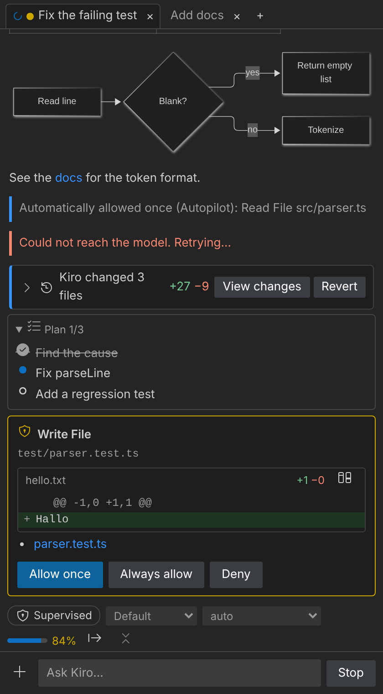
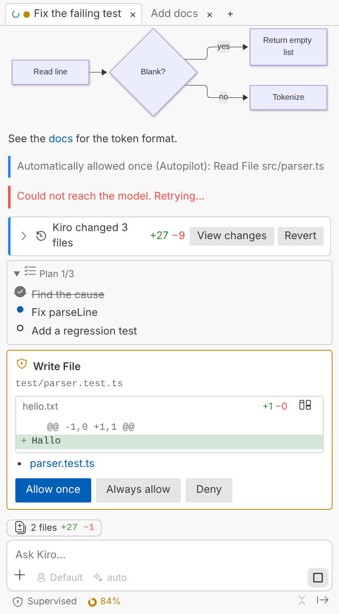
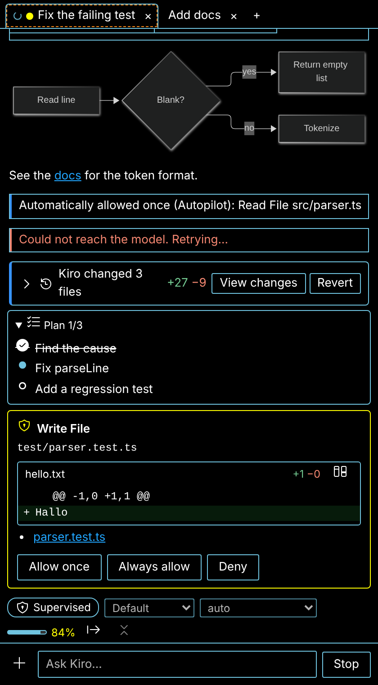
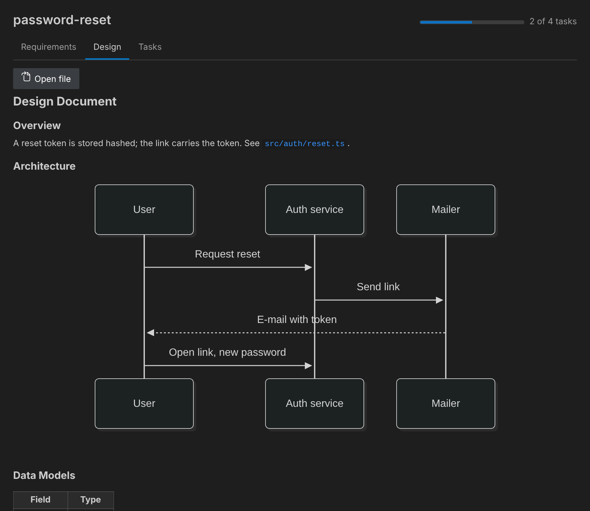
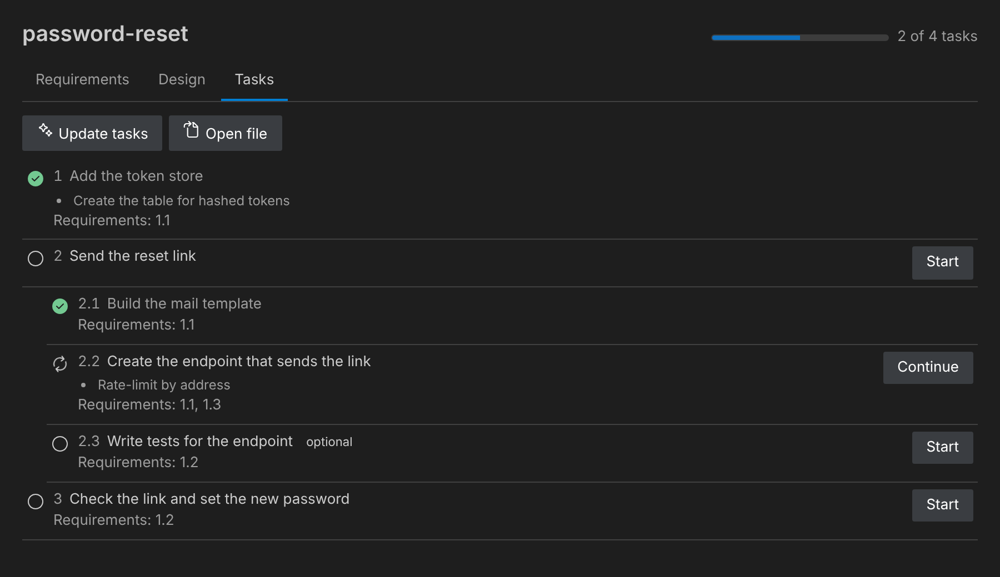

# Kiro Studio

A graphical VS Code front end for the locally installed [Kiro CLI](https://kiro.dev/docs/cli/), built on the Agent
Client Protocol (ACP): a chat with streaming answers, diffs, checkpoints you can revert, and views for your sessions,
specs, steering files, hooks, MCP servers and agents.

> **Unofficial.** Kiro Studio is an independent project. It is not affiliated with, endorsed by, or sponsored
> by AWS or Kiro. "Kiro" is a trademark of its owner. This project ships no Kiro logos or other Kiro assets.

> **Preview.** All phases of the plan are built and tested against a scripted stand-in for the CLI and, for the parts
> that do not need it, against real Git and a real VS Code. Apart from the author's probe runs it has not been tried
> against a real Kiro CLI, so expect rough edges. [docs/PLAN.md](docs/PLAN.md) lists what is assumed and how to check it.

<p align="center">
  
  
  
</p>

_Sample data, rendered by the project's own preview script (`npm run preview`) in three themes; not a recording of a
real Kiro session._

## What it does

- **Chat** in the sidebar or an editor tab, with sessions as tabs. Streaming Markdown, highlighted code, Mermaid diagrams,
  Kiro's reasoning as it streams (when the CLI sends it), "Kiro is thinking…" until a turn shows something, tool calls
  as cards with diffs, the plan, `/` commands, `#` context (files, folders, the open file, the selected lines, problems,
  `git diff`, steering files, specs) and pasted or dropped images. ↑ and ↓ in the empty input bring back earlier
  messages. Agent, model and effort are picked in the input box; Supervised/Autopilot, the context fill (with tokens) and
  the credits of the session sit below it, and a chip above it opens Kiro's latest changes. Under every answer: the
  credits it cost and how long it took. At the bottom right, in the chat and in the status bar, an overview of your plan:
  monthly credits used, the reset day and bonus credits.
- **From the editor:** _Kiro Studio_ in the editor's context menu adds the selected lines or the file to the chat, or
  asks Kiro to explain or fix the selection; the explorer adds files and folders. Errors and warnings offer _Fix with
  Kiro_ among their quick fixes. <kbd>Ctrl</kbd>+<kbd>Alt</kbd>+<kbd>K</kbd> (<kbd>Cmd</kbd>+<kbd>Alt</kbd>+<kbd>K</kbd>)
  adds the selection, or opens the chat when nothing is selected; <kbd>Ctrl</kbd>+<kbd>Alt</kbd>+<kbd>N</kbd> starts a
  session while the chat has the focus.
- **Questions from Kiro** are answered in the chat with exactly the options Kiro offered, with the change shown. In
  Autopilot, Kiro Studio allows each request once for you (see [Safety](#privacy-and-safety)); Supervised always asks.
- **Checkpoints:** every turn that changes files leaves a card with _View changes_ and _Revert_, backed by a separate
  Git repository in the extension's storage. Your own repository is never touched. Needs Git.
- **MCP servers from the chat:** ask Kiro in your own words ("add the Linear MCP server") and its answer shows a card.
  _Add…_ shows in a VS Code dialog exactly what is written where. Servers from Kiro Studio's list of known ones are
  written as listed; anything else is marked. You sign in in the browser from the card, and API keys go into a password
  field and VS Code's secret storage, never into a file.
- **Kiro panel:** your earlier sessions (open, search, fork where the CLI allows it), and your specs, steering files,
  hooks, MCP servers and custom agents, read from `.kiro` and `~/.kiro`, with the actions to create, switch on and off,
  and remove them. Edits keep your comments and formatting.
- **Specs:** an assistant starts a spec (feature with requirements or design first, bug fix, quick spec) in the right
  Kiro agent. A view per spec shows requirements, design (diagrams drawn) and tasks with progress, and lets you approve a
  document or ask for changes. _Start task_ over every open task in `tasks.md` asks Kiro to do it.
- Export a session as Markdown. English and German. Light, dark and high-contrast themes; keyboard and screen reader
  support; long sessions stay responsive.

<p align="center">
  
  
</p>

## Requirements

- **Kiro CLI with the V3 engine**, signed in (`kiro-cli login`). Run `kiro-cli update` if yours is older. The headless mode
  that needs `KIRO_API_KEY` is deliberately not used.
- **VS Code 1.93** or newer. Windows 11, macOS and Linux. A real file system (no virtual workspaces) and a trusted workspace.
- **Git** for checkpoints (everything else works without it).

## Getting started

1. Install **Kiro Studio** from the Extensions view (search for "Kiro Studio"), or a `.vsix` from the
   [releases](https://github.com/lldeters/kiro-studio/releases) with _Extensions: Install from VSIX…_, and open a folder.
   The **Kiro Studio** icon appears in the activity bar.
2. If the CLI is not found or you are not signed in, the view says so and offers the fix. _Kiro Studio: Open Getting Started_
   walks through it.
3. Start a session with **+** in the chat and ask something. The first start of the CLI can take a while (up to
   about 20 seconds on Windows).

## Settings

| Setting                                                   | Default      | What it does                                                                                                                             |
| --------------------------------------------------------- | ------------ | ---------------------------------------------------------------------------------------------------------------------------------------- |
| `kiroStudio.cliPath`                                      | empty        | Full path to `kiro-cli`. Empty searches `PATH` and the usual install locations.                                                          |
| `kiroStudio.autonomy`                                     | `supervised` | `supervised`: Kiro asks before it changes files and shows a review at the end of a turn. `autopilot`: no review. User settings only.     |
| `kiroStudio.autoAllowInAutopilot`                         | on           | In Autopilot, answer each permission request that offers "allow once" with "allow once". Never a permanent "always". User settings only. |
| `kiroStudio.checkpoints.enabled`                          | on           | Record what each turn changes, for _View changes_ and _Revert_.                                                                          |
| `kiroStudio.checkpoints.exclude`                          | empty        | More files and folders checkpoints leave out, in `.gitignore` syntax (`*.log`, `data/`).                                                 |
| `kiroStudio.checkpoints.maxFileSizeMB`                    | `10`         | New files larger than this are left out of checkpoints (the chat says so). `0`: no limit.                                                |
| `kiroStudio.hooks.enabled`                                | off          | Let Kiro load and run hooks, **including your global ones**. User settings only.                                                         |
| `kiroStudio.mcp.addFromChat`                              | on           | Let Kiro suggest MCP servers as cards you add with a click (about 900 tokens per answer). User settings only.                            |
| `kiroStudio.planUsage.enabled`                            | on           | Plan overview at the bottom right, from `kiro-cli chat --no-interactive /usage` (may leave an empty CLI session).                        |
| `kiroStudio.specs.codeLens`                               | on           | _Start task_ and _Update tasks_ above the tasks in `tasks.md`.                                                                           |
| `kiroStudio.quickFix`                                     | on           | _Fix with Kiro_ among the quick fixes of an error or warning.                                                                            |
| `kiroStudio.defaultMode`, `defaultModel`, `defaultEffort` | empty        | Agent, model and effort to select in new sessions. Empty keeps Kiro's default. The agent: user settings only.                            |
| `kiroStudio.logging.level`                                | `messages`   | How much of the conversation with the CLI goes to the _Kiro Studio: Protocol_ output channel.                                            |

## Privacy and safety

- Kiro Studio starts your local Kiro CLI and talks to it over standard input and output. It has **no telemetry** and
  makes no network requests of its own; the CLI talks to Kiro's service with your account, as it does in a terminal.
- It starts an agent that can read and change files and run commands, so it **stays off in untrusted workspaces**.
- **Autopilot** (with the setting above) answers _allow once_ for you. Kiro's own deny rules still apply, because Kiro does
  not ask for what it denies; Kiro's ask rules are answered. A permanent "always" is never chosen for you, the end-of-turn
  review stays yours, and every automatic answer is shown in the chat. Switch the setting off to be asked every time.
- **Hooks** run only after you turn them on, and then also your global hooks from `~/.kiro/hooks`.
- **MCP servers from the chat** are written only after you confirm a VS Code dialog that shows the address or command and
  the file. API keys you enter stay in VS Code's secret storage and reach only the `kiro-cli` process, as environment
  variables (so commands Kiro runs can see them too). In Autopilot, Kiro's own attempts to change MCP servers are left to
  you. Pages Kiro wants to open ask first, except the sign-in page right after you add a server or click _Sign in in
  browser_.
- The protocol log hides tokens, e-mail addresses and your home folder. Values of `env` and headers of MCP servers are never
  read out; only their names are shown. Kiro's own session files are never read or written directly.
- Checkpoints live in the extension's storage, not in your repository.

## Known limits

- Not yet checked against a real CLI beyond the author's probe runs; [docs/PLAN.md](docs/PLAN.md) (sections 9 to 13 and 15)
  lists every assumption, for example the format of `tasks.md` and what the CLI does when you reject a review.
- Adding MCP servers from the chat is built on reading the shipped code of Kiro CLI 2.34.2, not on a run. A CLI that
  cannot start a sign-in for Kiro Studio says so on the card and asks you to update it.
- Sessions of a remote Kiro are listed but not driven specially.

## More

- [docs/PLAN.md](docs/PLAN.md): architecture decisions, phases, risks, assumptions and how to check them (German)
- [docs/ARCHITECTURE.md](docs/ARCHITECTURE.md): how the pieces fit together
- [docs/protocol-notes.md](docs/protocol-notes.md): what `kiro-cli acp` does on the wire, with the evidence for each statement
- [CHANGELOG.md](CHANGELOG.md)
- [`scripts/probe-acp.ts`](scripts/probe-acp.ts): starts the ACP server in a throw-away folder and records every message

## Development

Requires Node 22 (the packaging tool needs it) and, to try the extension, a signed-in Kiro CLI.

```bash
npm ci
npm run build              # bundle to dist/extension.js; press F5 ("Run Extension") to try it
npm run typecheck && npm run lint && npm test
npm run test:integration   # downloads VS Code; the CI runs it on Linux, macOS and Windows
npm run package            # dist/kiro-studio.vsix
```

Releases: [docs/RELEASING.md](docs/RELEASING.md) (one-time setup, the check with a real CLI, publishing; German).

## Running the probe

Requires Node 20+ and a Kiro CLI that is installed and signed in (`kiro-cli whoami`).

```bash
npm ci
npm run probe -- --help
npm run probe -- --no-prompt    # handshake and session only, no credits
npm run probe                   # also sends one tiny prompt
```

Output goes to `probe-logs/<timestamp>/` (`summary.json`, `wire.ndjson`, `stderr.log`), which is git-ignored. The
logs are redacted on a best-effort basis; read them before sharing. `npm run validate-wire -- <wire.ndjson>`
checks which recorded messages the ACP SDK's own schemas would reject. `--help` also lists the MCP probes P1 to P6
(sign-in, steering, live reload; see [docs/protocol-notes.md](docs/protocol-notes.md), section 17).

## License

Apache License 2.0, see [LICENSE](LICENSE).
